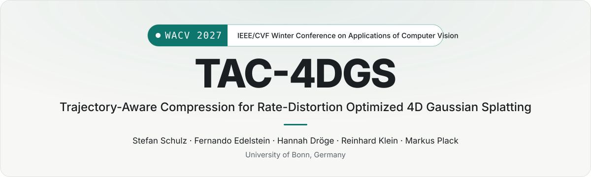

<!-- markdownlint-disable MD033 MD041 -->

  <a href="https://stefanmschulz.github.io/TAC-4DGS_webpage">
    <picture>
      <source media="(prefers-color-scheme: dark)" srcset="assets/readme/banner-dark.svg">
      <source media="(prefers-color-scheme: light)" srcset="assets/readme/banner-light.svg">
      
    </picture>
  </a>

  
  
  

  Source of the project page for our WACV&nbsp;2027 paper. 
  TAC-4DGS brings the trajectories of 4D Gaussian Splatting under rate-distortion optimized entropy coding: 
  <b>41.9%</b> smaller bitstreams on N3V and <b>33.8%</b> on Technicolor at nearly unchanged quality, with no changes to the renderer.

  
   
  Technicolor <i>Birthday</i>, decoded from the compressed bitstream and rendered live in the browser on the project page.

